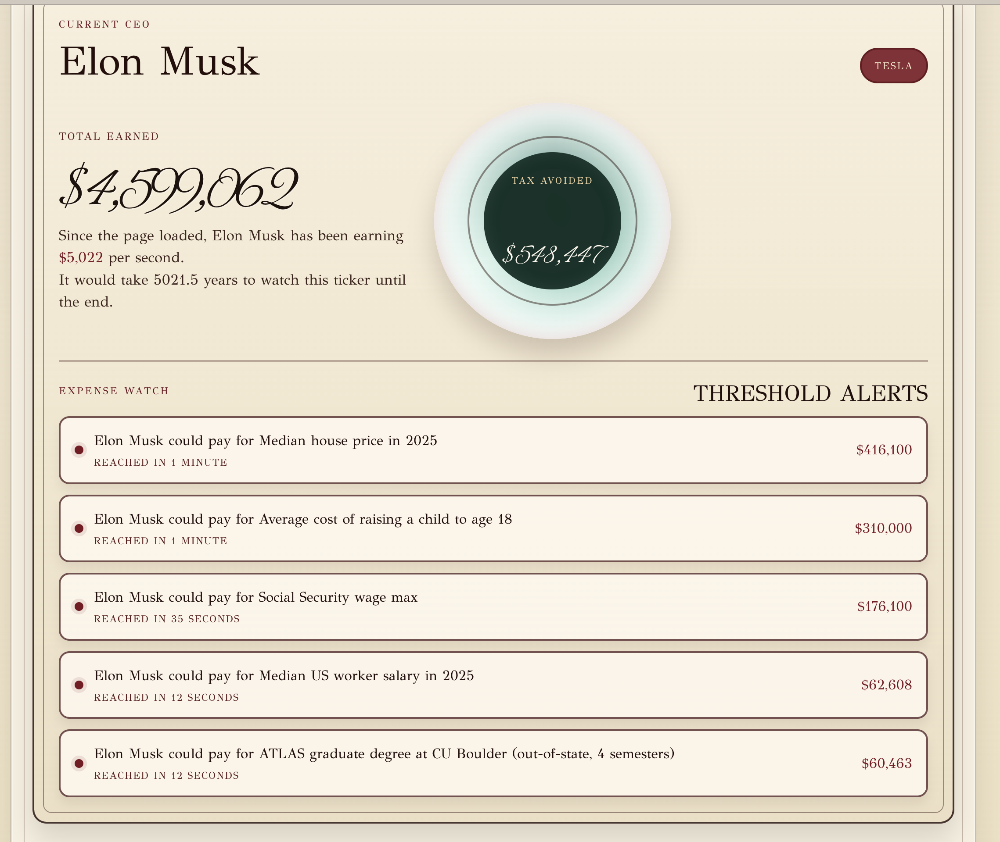
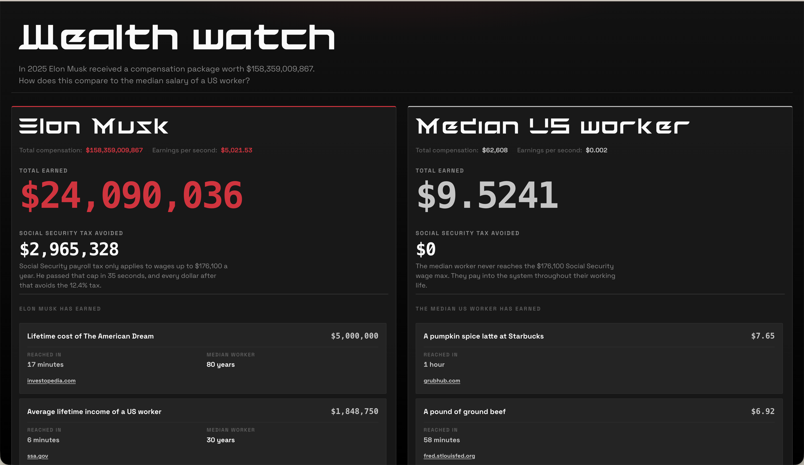

# Wealth Watch

React + Vite app. Live comparison of Elon Musk’s 2025 Tesla pay vs the median US worker salary.

## What it does

Annual pay becomes earnings per second. Two tickers run side by side:

- Left: CEO total, milestones as they cross
- Right: median worker total, same milestones

Milestones come from `expenses_2025.json`. Each alert shows time to reach that amount.

## Run

```bash
npm install
npm run dev
```

```bash
npm test
npm run build
```

## Data

I compiled a list of common goods and built my own dataset for them, with sources, in `expenses_2025.json`. CEO numbers come from AFL-CIO Executive Paywatch in `highest_paid_ceos_top100.json`.

I originally wanted to compare a few different CEOs to the median US worker. Then I looked at Elon’s package. It was so absurd it blew away even the next highest paid CEO, so I just ran with that.

## Vibecoding process

I wanted to try vibecoding since I left engineering for a design role before the AI craze, and hadn’t really sat down with these tools. I also didn’t have a design system, so I was curious how far I could get without an extensive setup. Just pure bots out of the box. 

Honestly, it was frustrating. It was hard to keep up with what the bots were making. The first passes were overly verbose and horribly ugly. I spent more time digging through the code just to follow the logic than I’d like to admit.

I installed ponytail to cut the verbosity and refactor things into something lighter. Getting the project to a place that didn’t scream AI was a struggle. I’m still not sure the end result gets there. 

What was helpful was getting the core logic mapped out quickly. I can see that this would be useful to just get a quick prototype up and running without focusing too much on the overall design. However, I still think these tools have a long way to go when it comes producing less generic and interesting layouts. 

### Evolution and tool exploration

#### Very sad early state vibecoded results :(




#### Slowly cleaning up the design, but still feeling soulless
* Fixed a lot of the layout and typography by hand to create a more cohesive color palette. Fighting with the bots wasn't worth it at this stage. 


#### Explored unicorn.studio for embeddable shaders and they were very cool! But I got pay walled 


#### Explored using Three.js, which was the most promising 
* Overall, the glitch effect was too strong. I would like to continue exploring this path with more time.


## How the code settled

- `fetch` both JSON files on mount. Rate: `annualCompensation / secondsInYear`.
- Threshold math in `expenseThresholds.js` (durations, Social Security savings, which expenses fire). Covered by `npm test`.
- `App.jsx` runs both clocks on one `requestAnimationFrame` loop at different rates. Refs hold totals so each frame can detect new thresholds.
- Tried Unicorn Studio and a Three.js glitch header; dropped both. Final header is a static image + CSS.
- Cleanup pass removed dead code. Small tree: `App.jsx`, helpers, CSS variables.
